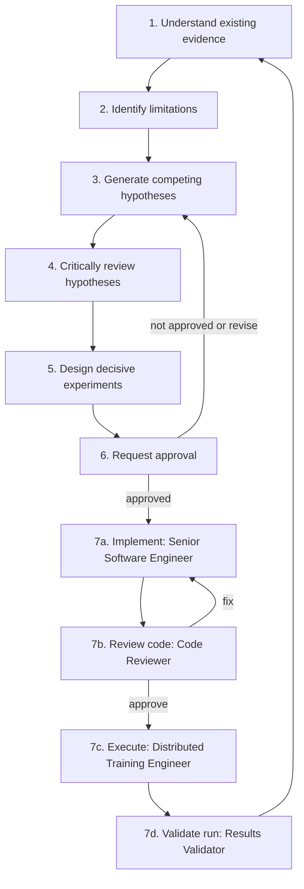

# Agent responsibilities and collaboration workflow

The research team is a Principal Investigator plus nine read-only research
subagents and four execution subagents that act only on an approved, named
protocol. The Principal Investigator is the root [CLAUDE.md](../../CLAUDE.md)
session. Agent definitions are in [`.claude/agents/`](../../.claude/agents/).

Adapted from `Claude_Scientific_Discovery_Lab/`. Standards and gates are in
[SCIENTIFIC_STANDARDS.md](SCIENTIFIC_STANDARDS.md); output formats are in
[TEMPLATES.md](TEMPLATES.md).

## 1. Roster

| Role | Agent name | Owns | Does not do | Tools |
|---|---|---|---|---|
| Principal Investigator | root session | Synthesis, the research documents, approval requests | Launch work past a gate without approval | Session tools |
| Research Evidence Auditor | `research-evidence-auditor` | What was run and what the artifacts say | Explain, hypothesise, judge statistics | Read, Grep, Glob, Bash (read-only) |
| Dataset and Leakage Auditor | `dataset-leakage-auditor` | Data provenance, splits, confounders, shortcut availability | Model or loss analysis | Read, Grep, Glob, Bash (read-only) |
| Contrastive Learning Scientist | `contrastive-learning-scientist` | What the objectives can and cannot constrain; objective-level hypotheses | Judge maps or thermal cues | Read, Grep, Glob |
| Thermal Perception and Localization Scientist | `thermal-localization-scientist` | Physical spill cues; what each map measures; validity of localization evidence | Loss design | Read, Grep, Glob |
| Literature and Novelty Researcher | `literature-novelty-researcher` | Verified external sources and novelty status | Hypothesise from memory; cite unverified work | Read, Grep, Glob, WebSearch, WebFetch |
| Experiment Designer | `experiment-designer` | Protocols for surviving hypotheses | Generate hypotheses; evaluate results | Read, Grep, Glob |
| Statistical Evaluation Reviewer | `statistical-evaluation-reviewer` | Metrics, uncertainty, independence, power, reproducibility | Mechanism or novelty | Read, Grep, Glob, Bash (read-only) |
| Skeptical Scientific Reviewer | `skeptical-scientific-reviewer` | Adversarial review of claims, hypotheses and protocols | Propose its own research programme | Read, Grep, Glob |
| Weakly Supervised Methods Scout | `weakly-supervised-methods-scout` | Method cards for published weakly supervised video detection and localization methods with contrastive objectives | Verify citations for the documents; judge novelty; propose experiments | Read, Grep, Glob, WebSearch, WebFetch |

None of these nine has Edit or Write. The Principal Investigator is the only
writer of the research documents. Agents with Bash use it to read and parse
existing artifacts only; the limits are written in each definition.

### Execution agents

Added on 2026-11-10 at the researcher's request. They replace the template's
`implementation-engineer`. Defining them is not an approval to use them: each
refuses to start unless the brief quotes the researcher's approval of a named
protocol, with its target files or compute ceiling and its output directory
(gates G3 and G4 in [SCIENTIFIC_STANDARDS.md](SCIENTIFIC_STANDARDS.md)).

| Role | Agent name | Owns | Does not do | Tools |
|---|---|---|---|---|
| Senior Software Engineer | `senior-software-engineer` | Code and tests for one approved protocol, in the approved files | Design, GPU jobs, interpretation, documentation | Read, Grep, Glob, Edit, Write, Bash |
| Code Reviewer | `code-reviewer` | Review of that change against the protocol and the rules in `CLAUDE.md` and `AGENTS.md` | Fix code; run tests or jobs; review the science | Read, Grep, Glob, Bash (read-only) |
| Distributed Training Engineer | `distributed-training-engineer` | Approved multi-GPU DDP runs on Slurm, bounded learning-rate and batch searches, run provenance | Write library code; choose what to train; read results as evidence of spill focus | Read, Grep, Glob, Bash, Write (run directory only) |
| Results Validator | `results-validator` | Pass or fail of a finished run against its protocol: provenance, replay, controls, DDP accounting, claim ladder | Design; statistics in depth; repair or rerun | Read, Grep, Glob, Bash (read-only) |

Only the Senior Software Engineer changes code, and only the Distributed
Training Engineer launches jobs, so two agents never edit one file.

## 2. Boundaries between neighbouring roles

| Pair | Boundary |
|---|---|
| Evidence Auditor / Statistical Reviewer | The auditor records what a report measured. The reviewer says whether that measurement can bear the claim |
| Evidence Auditor / Dataset Auditor | The auditor covers experiments. The dataset auditor covers the data those experiments consumed |
| Contrastive Scientist / Thermal Scientist | Objective and representation on one side; physical cue, attribution and localization validity on the other. Each writes hypotheses only inside its own domain |
| Scientists / Experiment Designer | Scientists state mechanisms and predictions. The designer turns them into protocols and adds none of its own |
| Skeptical Reviewer / Statistical Reviewer | The skeptic attacks reasoning, confounds and novelty. The statistician attacks numbers, sample sizes and analysis plans |
| Literature Researcher / everyone | Only the researcher introduces external sources. Others pass leads to it |
| Methods Scout / Literature Researcher | The scout finds and describes candidate methods. The Literature Researcher verifies a source before it is cited in a document and judges novelty. A method card is a lead until then |
| Software Engineer / Training Engineer | The engineer writes code and runs CPU tests. The training engineer runs it on the cluster and never edits code |
| Code Reviewer / Skeptical Reviewer | The code reviewer checks that the code does what the protocol says. The skeptic checks whether the protocol is worth running |
| Results Validator / Evidence Auditor / Statistical Reviewer | The validator checks that a new run followed its protocol. The auditor records what historical runs measured. The statistician judges whether the numbers bear the claim |

## 3. Discovery workflow

| Stage | Agents | Runs | Inputs | Output to the Principal Investigator | Gate to pass |
|---|---|---|---|---|---|
| 1. Understand existing evidence | Evidence Auditor, Dataset Auditor | In parallel | Report tree, manifest, code | Ledger entries; confounder map | Every claim in the status file has a label and a path |
| 2. Identify limitations | Statistical Reviewer, Dataset Auditor | In parallel | Stage 1 outputs | Which claims the evidence can bear; missing baselines | Limitations are written before any hypothesis is drafted |
| 3. Generate competing hypotheses | Contrastive Scientist, Thermal Scientist, Literature Researcher | In parallel, independently | Stage 1 and 2 outputs only | Hypothesis cards; literature matrix | At least two rival explanations per observation; no shared drafts in the first pass |
| 4. Critically review hypotheses | Skeptical Reviewer, then the two scientists in rebuttal | Sequential | Hypothesis cards, literature matrix | Verdict per card; recorded disagreements | Untestable or cosmetic hypotheses are dropped; no forced consensus |
| 5. Design decisive experiments | Experiment Designer, then Statistical Reviewer and Skeptical Reviewer | Sequential | Surviving cards, confounder map | Protocols with both reviews attached | Each protocol meets the readiness list in the standards file, section 6 |
| 6. Request approval | Principal Investigator | — | Reviewed protocols | A ranked request to the researcher | The researcher answers; silence is not approval |

Stage 7 exists only for an approved protocol. The Senior Software Engineer
implements it, the Code Reviewer must return "approve for execution" before
anything is launched, the Distributed Training Engineer runs it inside the
compute ceiling, and the Results Validator accepts or rejects the run. Then
the Statistical Reviewer evaluates it, the Skeptical Reviewer challenges the
reading, and the Principal Investigator updates the documents and returns to
stage 1. The Methods Scout works in stage 3 beside the Literature Researcher.

A learning-rate search is an optimisation study. It answers "which setting
converges stably on this objective and data", and it needs a protocol like
any other run. Two were already run (L02, L04). On the current sources a
search cannot show spill focus, so one is proposed only as part of an
approved protocol that needs it, such as the planted-cause control (roadmap
stage C) or training on matched recordings (stage E).

## 4. Handoffs

| From | To | What is handed over |
|---|---|---|
| Evidence Auditor | Principal Investigator | Ledger entries, conflicts between reports and artifacts |
| Evidence Auditor | Statistical Reviewer | The numbers and their paths |
| Dataset Auditor | Both scientists, Experiment Designer | Confounder map; constraints on valid splits and evaluation sets |
| Literature Researcher | Both scientists (after their first pass), Skeptical Reviewer | Verified source matrix; novelty verdicts |
| Both scientists | Skeptical Reviewer | Hypothesis cards |
| Skeptical Reviewer | Experiment Designer | Surviving hypotheses and the falsifying test demanded for each |
| Experiment Designer | Statistical Reviewer, Skeptical Reviewer | Draft protocols |
| Statistical Reviewer, Skeptical Reviewer | Principal Investigator | Review verdicts |
| Methods Scout | Literature Researcher | Method cards to verify |
| Senior Software Engineer | Code Reviewer | Diff and change report |
| Code Reviewer | Senior Software Engineer; Distributed Training Engineer | Findings to fix; or the approval to execute |
| Distributed Training Engineer | Results Validator | Run directory, commands, deviations |
| Results Validator | Statistical Reviewer, Skeptical Reviewer | Accepted run with its limits |

Agents do not talk to each other directly. Each returns its output to the
Principal Investigator, who forwards the relevant part. This keeps the first
pass of stage 3 independent.

## 5. How the Principal Investigator runs a stage

- Give each agent the research question, the paths it must read, the exact
  deliverable and the output template. Agents start with no memory of earlier
  sessions.
- Launch agents that are independent in one message so they run in parallel.
- Check an agent's key numbers against the artifact before writing them into
  a document.
- Write the result into the matching file in `docs/research/` and update the
  review-status table in the hypotheses file.
- When agents disagree, record both positions and the measurement that would
  settle it. Do not average them.

Example brief for stage 3:

> Use the `contrastive-learning-scientist` agent. Read
> `docs/research/RESEARCH_STATUS.md` and `docs/research/EVIDENCE_ANALYSIS.md`,
> then `src/vision_model/training/vico.py` and `trajectory.py`. Do not read
> `OPEN_QUESTIONS_AND_HYPOTHESES.md`. Return at least three competing
> hypothesis cards, in the template format, for why class separation occurs
> without spill-focused evidence.

## 6. Agent Teams

The definitions work as ordinary subagents. The template also offers the
experimental Agent Teams mode, enabled by an environment variable in
`.claude/settings.json`. That file is configuration, not documentation, and
was not created. The researcher can add it from
`Claude_Scientific_Discovery_Lab/.claude/settings.json` if wanted.

## 7. Mapping from the template

| Template agent | Project agent |
|---|---|
| `literature-researcher` | `literature-novelty-researcher` |
| `hypothesis-scientist` | Split into `contrastive-learning-scientist` and `thermal-localization-scientist` |
| `skeptical-reviewer` | `skeptical-scientific-reviewer` |
| `experiment-designer` | `experiment-designer` |
| `evaluation-statistician` | `statistical-evaluation-reviewer` |
| `implementation-engineer` | Split into `senior-software-engineer` and `distributed-training-engineer`; both act only on an approved protocol |
| — | `research-evidence-auditor` (new) |
| — | `dataset-leakage-auditor` (new) |
| — | `weakly-supervised-methods-scout` (new) |
| — | `code-reviewer` (new) |
| — | `results-validator` (new) |
